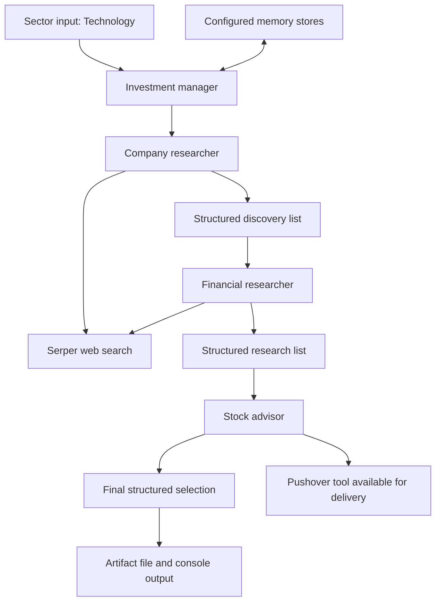

# Stock Advisor Agent

### A hierarchical AI workflow for company discovery, research synthesis, and notification delivery

A **Python and CrewAI research prototype** that separates company discovery, financial research, and final selection into specialized agent roles, coordinated by a manager agent. It combines Serper web search, Pydantic output models, persistent memory configuration, and a custom Pushover notification tool.

The engineering focus is the workflow: turn a broad sector request into structured research artifacts and provide an outbound delivery mechanism for the resulting summary.

[Orchestration](./Stock-Advisor-Agent-main/src/stock_advisor/crew.py) · [Agent roles](./Stock-Advisor-Agent-main/src/stock_advisor/agents.yaml) · [Tasks](./Stock-Advisor-Agent-main/src/stock_advisor/tasks.yaml) · [Saved artifacts](./Stock-Advisor-Agent-main/src/output/)

> **Status:** Research prototype with committed generated reports. The repository does not establish investment accuracy, profitable returns, reliable listing verification, or successful notification delivery. Generated financial assertions in saved reports are historical model outputs, not verified current market facts or investment recommendations from this documentation.

---

## The problem this project explores

Company research involves several different activities: finding candidates in news, investigating their position and outlook, comparing findings, and communicating a concise result. Combining those activities in a single prompt makes responsibilities and intermediate results harder to inspect.

This project models them as separate roles and tasks. Explicit task context connects discovery to research and research to selection. Structured output models give the intermediate reports a common shape, while the notification tool explores delivery beyond a terminal response.

## Intended business value

| Research need | Implementation approach |
|---|---|
| Begin with a sector rather than a predetermined ticker | Runtime sector input, currently `Technology` |
| Discover and investigate candidates | Two research roles with Serper search access |
| Coordinate specialized work | Hierarchical CrewAI process with a manager agent |
| Inspect intermediate findings | Separate discovery, research, and selection files |
| Preserve context between executions | Configured short-term, long-term, and entity memory |
| Deliver a concise result outside the console | Custom Pushover tool available to the advisor |

The intended benefit is a repeatable research-assistance workflow. Research time saved, factual accuracy, selection quality, financial returns, and notification reliability have not been measured.

## Four roles, three configured tasks

| Role | Responsibility | Explicit tools |
|---|---|---|
| Company researcher | Find companies and startups appearing in sector news | `SerperDevTool` |
| Financial researcher | Investigate discovered candidates and synthesize reports | `SerperDevTool` |
| Stock advisor | Select a candidate from the research and prepare a notification | `Push_Notification_Tool` |
| Investment manager | Coordinate work through the hierarchical process | No custom tool explicitly attached |

The crew includes **three worker agents and one manager agent**, not five independent worker agents. Web access is implemented through search; no dedicated webpage scraper, financial-statement parser, exchange feed, or brokerage connection appears in the source.



The diagram describes configured roles and handoffs. It does not prove which tools were called during the runs that produced the saved files.

## Structured task contracts

Pydantic models are attached through `output_pydantic`:

| Task | Output model | Configured relative destination |
|---|---|---|
| `find_trending_companies` | `TrendingCompaniesList` | `output/trending_companies_and_startups.json` |
| `research_trending_companies` | `TrendingCompaniesResearchList` | `output/fundamental_analysis_report.json` |
| `filter_out_best_stock` | `TrendingCompanyResearch` | `output/recommended_stock_advice.json` |

Discovery records contain company name, ticker, and a reason for news coverage. Research records contain name, market position, future outlook, and potential investment commentary. The source spells the market-position field `market_postion`; saved JSON uses that spelling too.

These schemas structure text. They do not validate that a ticker exists, that a company is publicly listed, that a numerical assertion is correct, or that an investment conclusion is justified. There are no required source URLs, observation timestamps, exchange identifiers, or financial-statement periods.

## What the saved artifacts show

Two output sets are committed under different working-directory locations:

| Location | Discovery artifact | Research artifact | Final artifact |
|---|---|---|---|
| `Stock-Advisor-Agent-main/output/` | Eight entries, all with `N/A` tickers | One company researched | One company selected |
| `Stock-Advisor-Agent-main/src/output/` | Five named companies with ticker strings | Five research records | One company selected |

The second discovery set contains NVIDIA, Broadcom, Cloudflare, Zebra Technologies, and Amazon. Their presence is evidence of generated artifact content, not an endorsement of those companies or validation of the accompanying claims.

### What can be concluded

- The repository contains discovery, research, and final-selection JSON artifacts.
- The saved records use the shapes defined by the Pydantic models.
- The source connects the three tasks through explicit context dependencies.

### What remains unproven

- The discovery prompt's publicly listed requirement is not reliably enforced: one saved set has only `N/A` tickers.
- The requested two-to-three-candidate limit is not enforced by the schema; saved sets contain eight and five entries.
- Complete research coverage is inconsistent: one set narrows eight candidates to a single research record without a recorded coverage check.
- Financial assertions have no attached citations or dates establishing their accuracy or freshness.
- No execution transcript connects the artifacts to particular tool calls, configurations, or successful Pushover deliveries.

No model, search, embedding, or notification calls were performed for this README.

## Memory implementation

`crew.py` enables crew memory and constructs three storage components:

- **Short-term memory:** `ShortTermMemory` with `RAGStorage` at `./memory/`, using OpenAI `text-embedding-3-small`.
- **Long-term memory:** `LongTermMemory` with SQLite storage at `./memory/long_term_storage.db`.
- **Entity memory:** `EntityMemory` with another `RAGStorage`, also configured with `type="short-term"` and the same base path and embedding model.

Both project-level and `src`-level memory directories contain committed database artifacts. Their presence does not prove effective recall or reliable avoidance of previously selected companies. The instruction not to repeat a company is prompt-based; no application-level unique selection ledger enforces it.

The shared storage configuration for short-term and entity memory should be reviewed for isolation and correct storage type. Relative paths also make the launch directory significant.

## Custom notification integration

The tool accepts `stock_recommendation_message` as either a string or dictionary. A dictionary is converted using its `description` field, with `"No message provided"` as the fallback.

It reads:

```text
PUSHOVER_USERTOKEN
PUSHOVER_API_TOKEN
```

Then sends an HTTP POST to Pushover with `user`, `token`, and `message` fields. A status code of 200 produces a JSON success string; other codes produce an error string containing the status code.

### Delivery limitations

- The code has no explicit request timeout, retry policy, network-exception handling, or credential preflight check.
- It checks HTTP status without inspecting the provider response body's delivery status.
- The task asks the agent to use the tool; application code does not independently require or record a successful call before returning the final result.
- There is no scheduler, market-event subscription, or continuous monitoring loop. Delivery is an on-demand capability, not a demonstrated real-time alerting service.

## Configuration considerations

### Model binding needs correction

The worker YAML entries use `model: groq/llama-3.1-70b-versatile`; the manager uses `model: openai/gpt-4o`. The locked CrewAI agent API exposes model selection through `llm`, and the constructors do not pass explicit `llm` arguments. These entries should not be treated as proof of the selected providers at runtime. Verify the binding and current model availability before running. See the [CrewAI 0.130.0 agent source](https://github.com/crewAIInc/crewAI/blob/0.130.0/src/crewai/agent.py).

### Final-output instructions conflict

The final task demands a one-sentence plain string with no JSON, while `crew.py` attaches `TrendingCompanyResearch` as its structured output model. The committed final artifacts are structured records. A clearer design would separate research selection from notification-message formatting and validate each independently.

### Unimplemented template commands

`stock_advisor` and `run_crew` target the implemented `run()` function. The `train`, `replay`, and `test` script entries reference functions absent from `main.py`.

### Failure handling is limited

`main.py` catches exceptions and prints an error. It does not re-raise them or explicitly return a nonzero exit status, which limits reliable failure detection by an external runner.

## Repository guide

```text
Stock-Advisor-Agent/
├── README.md
└── Stock-Advisor-Agent-main/
    ├── README.md
    ├── pyproject.toml
    ├── uv.lock
    ├── output/                     # First committed report set
    ├── memory/                     # Committed runtime storage
    └── src/
        ├── output/                 # Second committed report set
        ├── memory/                 # Additional runtime storage
        ├── uv.lock
        └── stock_advisor/
            ├── __init__.py
            ├── agents.yaml
            ├── tasks.yaml
            ├── crew.py
            ├── main.py
            ├── uv.lock
            └── tools/
                ├── __init__.py
                └── push_notifications_tool.py
```

Compiled cache directories also exist in the committed source tree. Runtime databases and compiled files should be separated from distributable source as the project matures.

## Development setup

The project declares Python `>=3.10,<3.14` and `crewai[tools]>=0.130.0,<1.0.0`. The project-level lockfile resolves CrewAI `0.130.0`.

```bash
git clone https://github.com/FaiazS/Stock-Advisor-Agent.git
cd Stock-Advisor-Agent/Stock-Advisor-Agent-main
uv sync --locked
```

Before starting an actual run:

1. Correct model binding and verify provider/model availability.
2. Configure `SERPER_API_KEY` for search and `OPENAI_API_KEY` for the explicitly configured embedding provider. If Groq is selected for workers, configure `GROQ_API_KEY` as well.
3. Configure `PUSHOVER_USERTOKEN` and `PUSHOVER_API_TOKEN` only when intentionally enabling outbound notifications.
4. Resolve the final-output contract conflict and use a designated test notification recipient during development.
5. Launch consistently from this project directory so `./memory/` and `output/` resolve predictably.

The intended console entry point is:

```bash
uv run run_crew
```

This is not a verified run instruction for an unchanged checkout. Running the workflow can invoke paid external services, write local memory and report files, and send notifications. `main.py` loads environment variables through `load_dotenv()` and currently supplies the fixed sector `Technology`.

## Next engineering milestones

1. **Make execution deterministic to configure:** Correct provider binding, remove stale script entries, standardize paths, and fail clearly when credentials are missing.
2. **Validate the candidate universe:** Check exchange listings and ticker mappings against an authoritative data source; enforce candidate counts and research coverage.
3. **Attach evidence:** Require source URLs, retrieval dates, reporting periods, and claim-level support for material financial assertions.
4. **Separate analysis from delivery:** Validate a structured selection, generate a concise notification from it, and record delivery independently.
5. **Harden integrations:** Add explicit timeouts, retries, provider response checks, and audit records for tool calls.
6. **Evaluate research quality:** Measure factual support, completeness, freshness, repeat-selection behavior, cost, and latency against a defined benchmark.
7. **Clean up runtime state:** Keep databases and caches outside the source tree and define retention, reset, and storage-isolation behavior.

These are proposed improvements. No price-prediction model, portfolio optimizer, backtest, trade execution, or production deployment is implemented in the reviewed source.

## Engineering skills demonstrated

**Multi-agent orchestration · Hierarchical delegation · Prompt engineering · Web-search integration · Pydantic output contracts · Custom CrewAI tools · HTTP API integration · Vector-memory configuration · SQLite persistence · Dependency locking**

The project's strongest portfolio contribution is connecting research roles, structured handoffs, persistent context, and an external delivery tool in one workflow. Establishing trustworthy financial conclusions requires the additional evidence and validation layers described above.

---

**Author:** [Faiaz Ahmed](https://www.linkedin.com/in/faiazahmed22/) · [GitHub](https://github.com/FaiazS)
